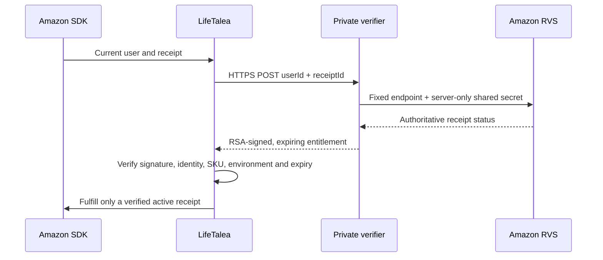

# Amazon billing and server verification — local implementation

**Public release remains BLOCKED.** The Supabase verifier is deployed with server-only credentials and a separate RSA identity. Production HTTPS/signature/invalid-receipt smoke passed; real App Tester sandbox purchase, restore and cancellation passed after fixing SDK cancellation precedence. Premium is Approved for TEST at the approved GBP4.99 price. One actual Amazon-distributed LAT purchase activated Premium through signed verification. Restore retained it and dialog cancellation retained Free; first-launch confirmation delay and the remaining LAT/acceptance gates are open. Final charge is unconfirmed. See AMAZON_LAT_STATUS.md. See AMAZON_SUPABASE_DEPLOYMENT.md.

Local engineering completed:

- A dependency-free Node 24 verifier with strict request shape, fixed Amazon endpoint/environment/SKU, canceled/invalid receipt handling, short-lived RSA assertions and redacted errors. It bounds body/response sizes, time, concurrency, client state and upstream calling rate. Redirects and insecure TLS configuration are rejected.
- Android verifies the pinned server signing key, issuer/audience, receipt/current SDK user, SKU, production/sandbox separation and time bounds. A legacy Premium boolean never grants access. Monotonic cache expiry resists wall-clock changes; cache requires the same boot counter and SDK identity. SDK-only responses never unlock production.
- Current SDK requests and async verifications carry identity generations. Restore verifies paginated receipts; late old-account results cannot overwrite a newer account. Verified revocation or a completed empty restore removes access. Transient failures can use a still-valid signed receipt already bound to the current account; they do not extend its lifetime.
- Fulfillment follows verification. Missing public backend configuration or a disabled purchase switch prevents initiating purchases. The switch cannot bypass receipt validation. Default release configuration intentionally has no endpoint/signing pin and purchases remain off.
- Added missing Amazon Appstore/App Tester package visibility for newer Android versions. Amazon's SDK authentication PEM remains separate from the verifier signing identity.
- Added server failure/HTTP/startup/key-generation tests, pure billing state/time tests and Node-signed public interoperability fixtures for real Android signature/parser tests. Tests use fictional transactions, not Amazon receipts. CI includes the server suite.
- QA now checks for a locked device and temporarily keeps an already-unlocked tablet awake during the test batch, restoring its original power setting. It never knows, enters or bypasses a PIN.

The exact executed counts and current APK hashes belong to `deliverables/reports/amazon-rvs-verification.json`, `device-test-run.json`, current JUnit files and `amazon-local-checks.json`. Those reports distinguish local contracts from live Amazon behavior; an older passing device run does not verify a rebuilt APK. Historical startup timeouts remain documented unless a specific cause/fix is demonstrated.

Current packages: `LifeTalea-Amazon-Supabase-server-2026-11-04.zip` and `LifeTalea-0.1.0-Amazon-LAT-review-2026-11-04.zip`. Their manifests validate every included byte. The server archive runs its core and edge tests after extraction. It contains no shared secret, private signing key, filled environment file or real receipt.

Next gates: execute the configured LAT candidate against the deployed verifier, including purchase, failures, restore, cancellation, account changes, interruptions and offline/reboot. App Tester sandbox success does not verify LAT or the production device TLS path. Assess the hosted identifier-processing disclosures, in-app privacy wording and Amazon questionnaire. Finish independent security, native-language, product/device, legal/export and signing gates before public promotion.

Official contract references: [RVS](https://developer.amazon.com/docs/in-app-purchasing/iap-rvs-for-android-apps.html), [SDK integration](https://developer.amazon.com/docs/in-app-purchasing/iap-implement-iap.html), [RVS sandbox](https://www.developer.amazon.com/docs/in-app-purchasing/rvs-cloud-sandbox.html).
