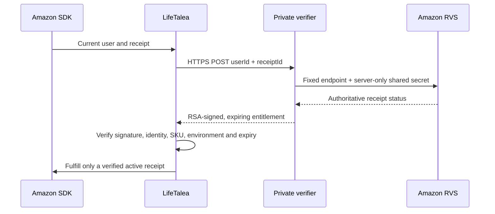

# Amazon billing and server verification — local implementation

**Release remains BLOCKED.** The private verifier and signed-entitlement client now exist; deployment, real account configuration and live Amazon transaction testing are not complete. The publisher chose local implementation and deployment packaging first. No host, paid service, product, price or account setting was created or changed.

Local engineering completed:

- A dependency-free Node 24 verifier with strict request shape, fixed Amazon endpoint/environment/SKU, canceled/invalid receipt handling, short-lived RSA assertions and redacted errors. It bounds body/response sizes, time, concurrency, client state and upstream calling rate. Redirects and insecure TLS configuration are rejected.
- Android verifies the pinned server signing key, issuer/audience, receipt/current SDK user, SKU, production/sandbox separation and time bounds. A legacy Premium boolean never grants access. Monotonic cache expiry resists wall-clock changes; cache requires the same boot counter and SDK identity. SDK-only responses never unlock production.
- Current SDK requests and async verifications carry identity generations. Restore verifies paginated receipts; late old-account results cannot overwrite a newer account. Verified revocation or a completed empty restore removes access. Transient failures can use a still-valid signed receipt already bound to the current account; they do not extend its lifetime.
- Fulfillment follows verification. Missing public backend configuration or a disabled purchase switch prevents initiating purchases. The switch cannot bypass receipt validation. Default release configuration intentionally has no endpoint/signing pin and purchases remain off.
- Added missing Amazon Appstore/App Tester package visibility for newer Android versions. Amazon's SDK authentication PEM remains separate from the verifier signing identity.
- Added server failure/HTTP/startup/key-generation tests, pure billing state/time tests and Node-signed public interoperability fixtures for real Android signature/parser tests. Tests use fictional transactions, not Amazon receipts. CI includes the server suite.
- QA now checks for a locked device and temporarily keeps an already-unlocked tablet awake during the test batch, restoring its original power setting. It never knows, enters or bypasses a PIN.

The exact executed counts and current APK hashes belong to `deliverables/reports/amazon-rvs-verification.json`, `device-test-run.json`, current JUnit files and `amazon-local-checks.json`. Those reports distinguish local contracts from live Amazon behavior; an older passing device run does not verify a rebuilt APK. Historical startup timeouts remain documented unless a specific cause/fix is demonstrated.

Deployment candidate: `deliverables/amazon-submission/LifeTalea-Amazon-RVS-server-2026-11-04.zip`. It contains only allowlisted source, runtime templates, tests and public fixtures. The package builder extracts its own checksum-verified ZIP into an isolated temporary folder and executes the server tests there. No private signing key, Amazon secret, filled env file or real receipt is included. The full updated review ZIP is `LifeTalea-0.1.0-Amazon-RVS-review-2026-11-04.zip`; neither archive is permission to submit or deploy. Docker execution is not claimed where Docker is unavailable.

Next integration gates:

1. Approve a private hosting destination and real credentials outside chat/source control; configure trusted HTTPS, gateway limits, operational logs/alerts and separate production/sandbox signing identities. Pin the matching public key in the app. See [service setup](../server/receipt-verifier/README.md).
2. Approve/create the ENTITLED product and marketplace prices, and configure App Tester/DevTest/LAT as appropriate. Decide the server policy for Amazon's production publishing/LAT test transactions; a production test flag is distinct from a sandbox environment.
3. Test real purchase, pending/failure, restoration, refund, account switching, lifecycle/interruption and offline/reboot scenarios before enabling purchases. Local fixtures do not certify SDK callback timing, Amazon credentials, TLS deployment or real entitlements.
4. Review the new identifier-processing disclosure and revise the saved Amazon privacy questionnaire for the actual host/data handling. Complete independent security, legal/export/signing, native-language, remaining product and device gates. No full security assessment, legal certification or production approval is claimed.

Official contract references: [RVS](https://developer.amazon.com/docs/in-app-purchasing/iap-rvs-for-android-apps.html), [SDK integration](https://developer.amazon.com/docs/in-app-purchasing/iap-implement-iap.html), [RVS sandbox](https://www.developer.amazon.com/docs/in-app-purchasing/rvs-cloud-sandbox.html).
