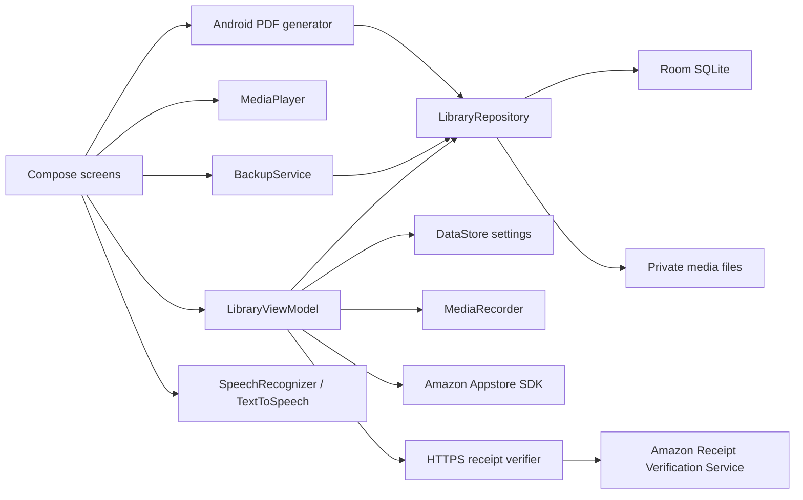

# LifeTalea architecture

LifeTalea is a native, local-first Android application. `android/app` is the Gradle application; `data`, `voice`, `billing`, `features` and `ui` are package boundaries inside it. They are not independent Gradle modules. Core journaling requires no account. Premium receipt verification uses an isolated Supabase Edge Function. The marketing website is a separate Next.js static export.

Memories have stable UUIDs, written content, editable transcripts, tags, event-date precision, optional manually entered locations, favourites and timestamps. Albums relate through a many-to-many junction with enforced foreign keys. Deleting an album removes links rather than memories. Attachments belong to memories and are copied into internal storage. Scrapbook pages reference memories without cascading deletion: a removed memory becomes a visible missing-source state.

Room operations run through suspend DAO functions or IO coroutines. Compose observes Flow through lifecycle-aware state collection. Screen/draft fields use saveable state. Recorder lifetime is owned by the ViewModel; the Activity saves active audio on stop, including backgrounding and rotation. There is no background-recording service. Playback releases resources on disposal and pauses when the app stops.

Backup format v1 uses JSON plus selected attachment bytes in ZIP, with SHA-256 attachment hashes. Optional encryption uses PBKDF2-HMAC-SHA256 (210,000 iterations, random 16-byte salt) and AES-256-GCM (random 12-byte IV). Restore limits compressed input, expanded content, item sizes and counts, validates names, UUIDs, dates, relationships and hashes, previews counts and keeps existing records. Import is transactional; newly staged files are removed if the transaction fails. Crash-consistent journalling across filesystem and database is a remaining hardening task; this is not a certified archival format.

The first released database schema is version 1 and is exported in `android/app/schemas`. No historical release exists to migrate. Destructive migration fallback is deliberately absent. Every future schema change needs an explicit migration and migration test before release.

Stories and media remain in local storage. INTERNET supports Amazon SDK communication and HTTPS receipt verification; receipt identifiers are sent to the verifier, which checks Amazon RVS and signs a short-lived entitlement assertion. The Amazon shared secret and assertion private key stay on the server. Device speech recognition is a separate installed service. Saved-file transcription has an explicit unavailable adapter, not a fabricated implementation. Media3, Hilt and WorkManager are not added because the current playback, dependency graph and foreground-only work do not require them.

Premium state is separate from memories. Debug builds have `.debug` application IDs and separate entitlement preferences. Production grants reject unknown/sandbox SDK modes. Cached entitlements support offline access; refunds/account changes are reconciled when Amazon returns valid responses. Receipt verification and sandbox/LAT purchasing remain release gates.

Current engineering limitations include a single application module, no historical migration tests, a bounded in-memory archive implementation (32 MiB cap, 16 MiB per attachment), no cloud sync, no automatic transcription, and pending complete localisation/device/security review. See RELEASE_READINESS.md for evidence-backed status.
